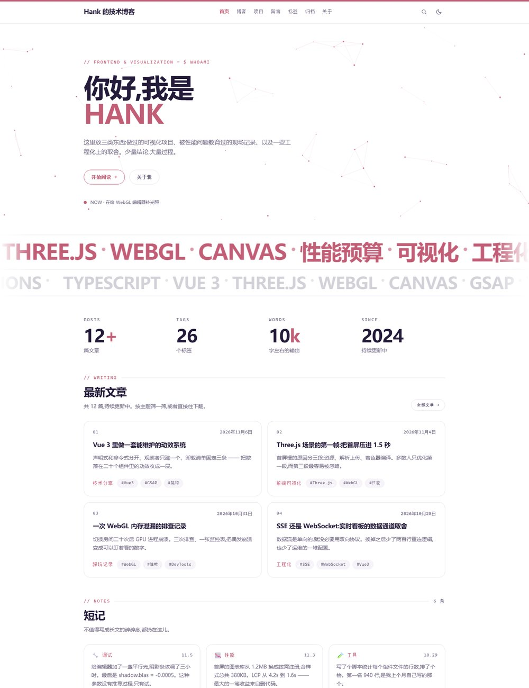
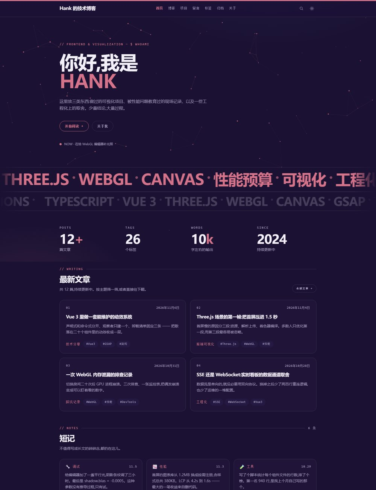
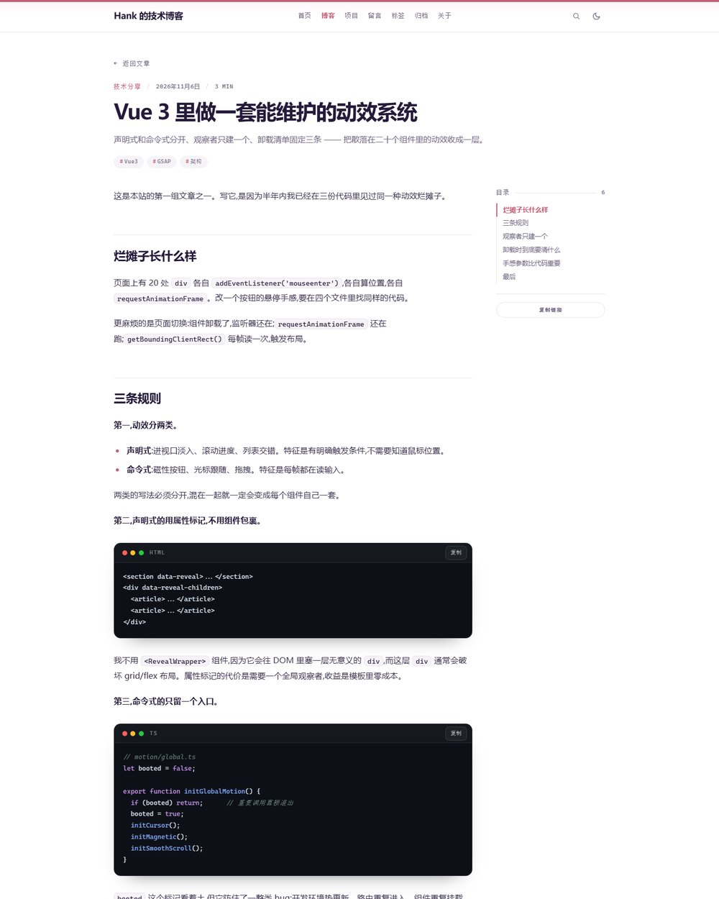
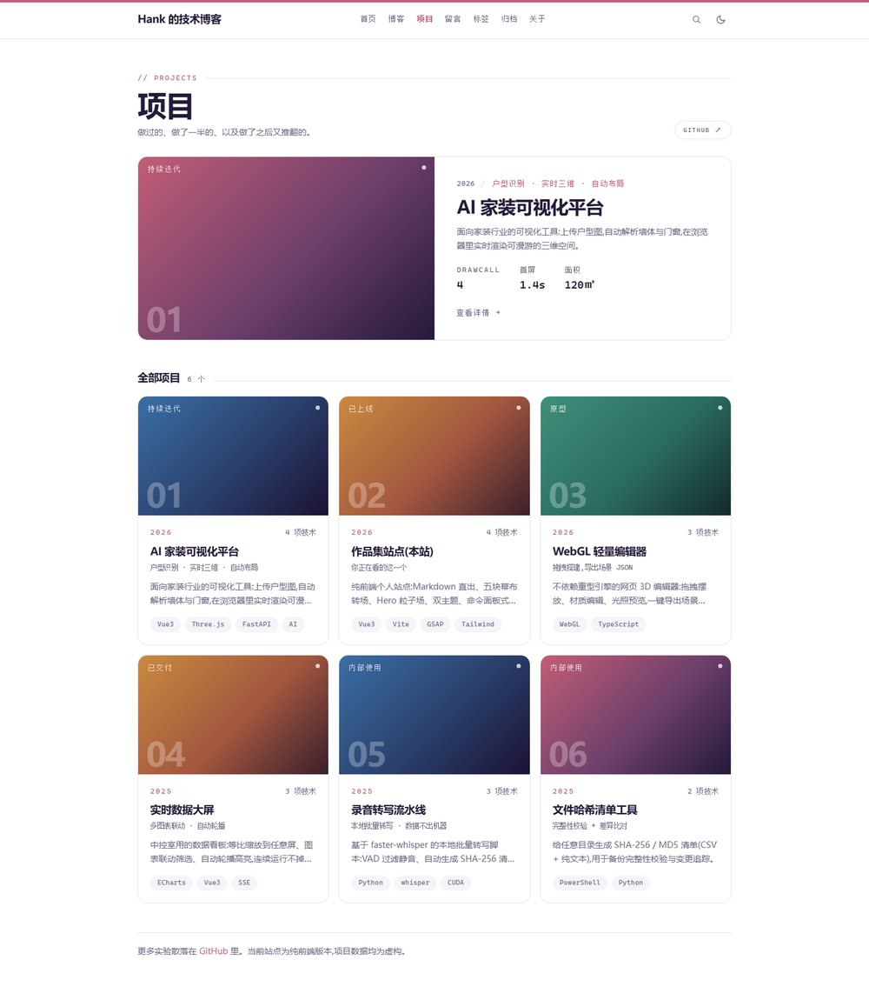

# Hank 的技术博客 · blog-frontend

一个纯前端的个人技术博客。视觉与动效对齐 [ulyssesyang.top](https://ulyssesyang.top/) 的设计语言:**白底打底 + 玫瑰红唯一点缀 + 深墨紫暗色主题**,超大双色标题、等宽大写小标签、巨型双跑马灯、细边框圆角卡片、五块幕布转场。

**当前不接后端**:所有文章、项目、留言都是虚拟数据;评论与留言写入浏览器 `localStorage`,只在本机可见。

## 预览

| 首页(浅色) | 首页(深色) |
| --- | --- |
|  |  |

| 文章详情 | 项目 |
| --- | --- |
|  |  |

---

## 快速开始

```bash
npm install
npm run dev        # http://localhost:5173
npm run build      # 产物在 dist/
npm run preview
npm run feed       # 重新生成 public/feed.xml
```

## 技术栈

| 用途 | 选型 |
| --- | --- |
| 框架 | Vue 3 (`<script setup>`) + Vue Router |
| 构建 | Vite |
| 样式 | Tailwind CSS + CSS 变量双主题 |
| 动效 | GSAP(+ ScrollTrigger) |
| 平滑滚动 | Lenis |
| 内容 | Markdown 原文 `?raw` 导入 + 自研渲染器 |

---

## 页面

| 路由 | 页面 | 说明 |
| --- | --- | --- |
| `/` | 首页 | Hero 粒子场、双跑马灯、数字统计、最新文章、短记、时间线、标签云 |
| `/blog` | 全部文章 | 分类筛选 + 按年份分组,卡片网格 |
| `/blog/:slug` | 文章详情 | 阅读进度、目录高亮、代码块 mac 窗口栏、系列横幅、上下篇、相关文章、评论 |
| `/projects` | 项目 | 主推项目 + 全部项目网格 |
| `/projects/:slug` | 项目详情 | 渐变封面、指标、技术栈、Markdown 正文、上下个项目 |
| `/tags` | 标签 | 标签云、全部标签、系列专栏 |
| `/tags/:tag` | 标签详情 | 该标签下的文章 |
| `/archive` | 归档 | 按年 / 月分组的时间线,年份快速跳转 |
| `/guestbook` | 留言板 | 本地留言、点赞、回复、留言须知 |
| `/about` | 关于 | 自我介绍、技术栈、现在在做什么、站内导航 |
| `*` | 404 | glitch 标题、快捷入口 |

## 交互动效

- **幕布转场**:五块竖条落下 → 新页面在幕布后渲染 → 幕布继续向下"穿页"。**每个会话只播一次**(`sessionStorage` 记账),首屏不播。
- **Hero 粒子背景**:粒子漂移 + 临近连线 + 鼠标斥力;按屏幕面积封顶数量、滚出视口暂停、切走标签页暂停、换页自动销毁、主题切换时换色。
- **光标环**:桌面端跟随光标的圆环,悬停可点元素时放大。
- **磁性按钮**:`.btn / .btn--solid / [data-magnetic]` 在光标靠近时被"吸住",离开时弹性归位。
- **双跑马灯 + 滚动变速**:用 `document.getAnimations()` 拿动画实例,滚动越快 `playbackRate` 越高(上限 5x)。
- **滚动显现**:IntersectionObserver + GSAP 交错淡入;并对"瞬间跳转"做了兜底扫描,避免内容卡在透明状态。
- **数字滚动**:统计数字进入视口后从 0 爬到目标值。
- **主题切换**:浅色 / 深色双主题,支持 View Transition API 的圆形扩散。**默认白底,不跟随系统深色**(与参考站一致);手动切过之后写入 `localStorage`,也可用 `?theme=dark` 强制指定。
- **搜索**:`Ctrl/⌘ + K` 或 `/` 唤起,客户端索引(文章 + 项目 + 短记),↑↓ 选择、↵ 打开、Esc 关闭,命中词高亮。
- **代码块**:红黄绿三点 + 语言标签 + 一键复制;自研轻量语法高亮。
- **阅读进度 / 目录高亮**:文章页顶部进度条,侧边目录随滚动高亮当前小节。
- **回到顶部**:滚动超过一屏后出现。
- **切走标签页改标题**:回来时再改回来。
- **彩蛋**:双击导航 logo、点 404 数字会蹦出随机文字。
- **无障碍**:`prefers-reduced-motion` 下关闭幕布 / 光标环 / 跑马灯,内容直接可见;键盘跳转正文链接;`aria-current` 标记当前导航。

---

## 目录结构

```text
src/
├── components/        展示组件(导航、页脚、卡片、目录、评论、搜索弹层…)
├── composables/       useTheme / useSearch / usePageChrome
├── content/posts/     Markdown 原文
├── data/              虚拟数据:文章、项目、短记、留言、站点配置
├── lib/               纯逻辑:markdown、格式化、搜索、动效、滚动、幕布
├── router/            路由与幕布守卫、标题、滚动复位
├── views/             页面
├── App.vue            页面骨架 + 路由过渡
├── style.css          设计令牌与全部组件样式
└── main.js            入口:主题、Lenis、全局动效
```

`lib/` 里不放任何 Vue 代码,只放可单测的纯函数。

---

## 改内容

### 加一篇文章

1. 在 `src/content/posts/` 新建 `my-post.md`;
2. 在 `src/data/articles.js` 顶部 `import` 并加入 `rawArticles`:

```js
import contentMyPost from "../content/posts/my-post.md?raw";

{
  slug: "my-post",
  title: "标题",
  date: "2026-11-10",
  category: "技术分享",
  tags: ["Vue3"],
  excerpt: "摘要",
  featured: true,           // 可选: 上首页
  series: { name: "系列名", index: 1, total: 3 }, // 可选
  content: contentMyPost,
}
```

3. `npm run feed` 重新生成 RSS。

阅读时长、字数统计、标签云、归档、系列、相关文章都会自动更新。

### 改站点信息

`src/data/site.js`:站名、简介、导航、社交链接、跑马灯词条(`ticker`,下半条用 `skills`)、技术栈。

### 改配色

`src/style.css` 顶部的 `:root` 与 `[data-theme="dark"]`:

| 令牌 | 浅色 | 深色 |
| --- | --- | --- |
| `--bg` | `#ffffff` | `#1b1233` |
| `--soft` | `#f6f4f8` | `#241942` |
| `--surface` | `#ffffff` | `#201539` |
| `--border` | `#e8e3ec` | `#38304d` |
| `--ink` | `#241a3a` | `#f3eff9` |
| `--muted` | `#6e6580` | `#a89fc0` |
| `--accent` | `#c25d76` | `#d4738a` |

颜色同时以 `--x-rgb` 三元组提供,所以 Tailwind 里可以写 `text-ink/60`、`bg-accent/10`。

### Markdown 支持

标题、段落、**粗体**、*斜体*、~~删除线~~、==高亮==、`行内代码`、链接、图片、无序 / 有序 / 嵌套列表、引用、表格、分隔线、``` 围栏代码块(带语言标签)。

---

## 接后端时要动的地方

| 位置 | 现在 | 之后 |
| --- | --- | --- |
| `src/data/articles.js` | `?raw` 导入本地 md | 换成接口请求 + 分页 |
| `src/data/projects.js` | 静态数组 | 接口 |
| `src/lib/search.js` | 构建期客户端索引 | 换服务端搜索或保留本地索引 |
| `CommentsPanel.vue` | `localStorage` | 换成评论接口 |
| `useTheme.js` | 本地存储 | 可加用户偏好同步 |

## 已知取舍

- 中文长标题允许在任意两字之间换行(CJK 排版默认行为),偶尔会把词拆开。
- 搜索是纯前端全量匹配,文章量很大时应换索引方案。
- `public/feed.xml` 是脚本生成的静态文件,新增文章后记得 `npm run feed`。
- 项目封面用 CSS 渐变代替截图,避免依赖外链图片。
